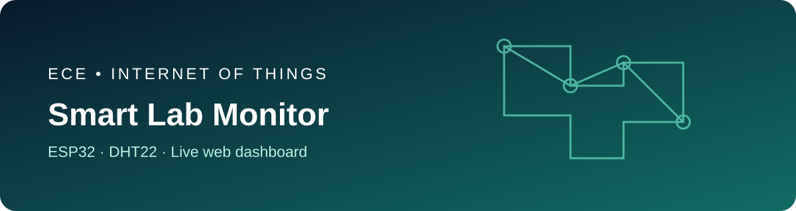
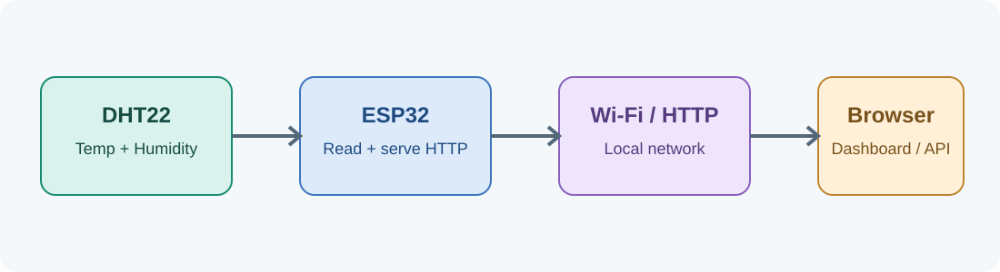

# ECE Smart Lab IoT Monitor



> An ESP32-based IoT prototype for live laboratory temperature and relative-humidity monitoring, with a browser dashboard and JSON endpoint.

**Author:** Mohammed Adil · Electronics & Communication Engineering  
**Project stage:** Learning prototype — hardware validation is still required.

## Project overview

A DHT22 sensor measures the environment. An ESP32 reads the sensor, connects to Wi-Fi, and serves a small web dashboard plus a JSON API. The dashboard refreshes every three seconds while open on a device connected to the same network.

## System architecture



**Data flow:** DHT22 → ESP32 → Wi-Fi / HTTP → browser dashboard or API client.

## Hardware and wiring

| DHT22 | ESP32 DevKit |
|---|---|
| VCC | 3V3 |
| DATA | GPIO 4 |
| GND | GND |

Use a DHT22 module with a built-in pull-up resistor, or add a 4.7k–10kΩ pull-up from DATA to 3V3. Confirm the pinout of your specific module before powering it.

## Software setup

1. Install Arduino IDE and the ESP32 board support package.
2. Install **DHT sensor library** by Adafruit and **Adafruit Unified Sensor** from Library Manager.
3. Open `firmware/esp32_lab_monitor/esp32_lab_monitor.ino`.
4. Enter your Wi-Fi SSID and password locally in the sketch. Do not commit real credentials.
5. Select your ESP32 board and port, then upload.
6. Open Serial Monitor at **115200 baud**. Visit the IP address printed after connection, from a device on the same Wi-Fi.

## API

The firmware exposes:

- `GET /` — live dashboard
- `GET /api/readings` — JSON sensor readings

Example response:

```json
{"temperature_c":24.8,"humidity_pct":51.2,"status":"normal"}
```

## Repository map

- `firmware/esp32_lab_monitor/` — ESP32 Arduino sketch
- `docs/project-explanation.md` — project details, flow, limitations, and future work
- `docs/architecture.svg` — architecture diagram
- `assets/banner.svg` — project banner
- `CONTRIBUTING.md` — contribution guidance

## Applications and learning outcomes

This project is a hands-on demonstration of sensor interfacing, embedded programming, Wi-Fi networking, HTTP, JSON, and a simple web UI. It can support classroom demonstrations and non-critical environmental observation.

## Safety, privacy, and limitations

- Use low-voltage USB power. Never connect an ESP32 directly to mains electricity.
- The example uses plain HTTP on a local network; do not expose it directly to the public internet.
- Sensor accuracy depends on placement, calibration, and module quality.
- Validate readings against a reference instrument before making accuracy claims.
- This is not a certified safety or medical monitoring system.

## Roadmap

- [x] Sensor reading and local HTTP endpoint
- [x] Browser dashboard with periodic refresh
- [x] Wiring and architecture documentation
- [ ] Physical testing and calibration notes
- [ ] MQTT support and historical data storage
- [ ] Authenticated remote access

## License

MIT. See [LICENSE](LICENSE).
